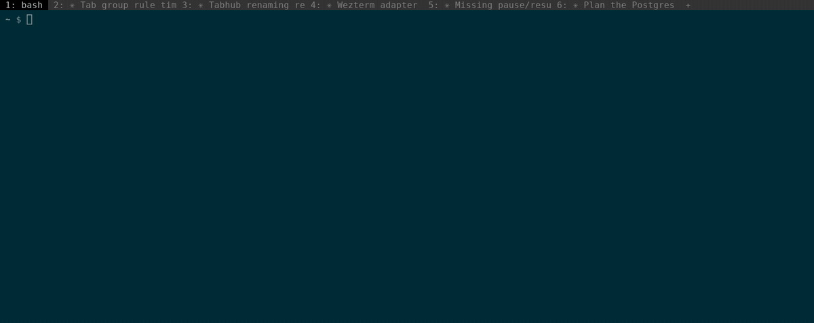

# claude-term-tabs

[](https://www.npmjs.com/package/claude-term-tabs)
[](https://github.com/ecoutu/claude-term-tabs/actions/workflows/release.yml)
[](LICENSE)

Find a running Claude Code session by what you remember about it, and switch to its terminal tab.



```bash
ctt working on pause in claude-term-tabs
# → Pause sessions before a restart · claude-term-tabs · tab 4
```

Works with iTerm2 on macOS, and WezTerm on macOS and Linux.

## Install

Needs Node 24 or later. `fzf` is optional; without it the picker is a numbered list.

```bash
npm install --global claude-term-tabs   # installs both claude-term-tabs and ctt
npx claude-term-tabs pause              # or run it without installing
```

To run it from a clone instead, link the clone with `npm link`.

The first switch in iTerm2 asks macOS for permission to control iTerm2. Allow it, or grant it
later in System Settings > Privacy & Security > Automation.

### Tab completion

`ctt completion zsh` or `ctt completion bash` prints a completion script (plain `ctt completion` picks
the shell from `$SHELL`). Append it to your shell's startup file:

```bash
ctt completion zsh >> ~/.zshrc     # after compinit runs
ctt completion bash >> ~/.bashrc   # bash 4 or later
```

Tab then completes ctt's subcommands (`pause`, `resume`, `completion`) as the first word, each one's
flags, and the terminal names after `--terminal`; after `--snapshot` it falls back to file names. It
never completes session titles. The script completes both `ctt` and `claude-term-tabs`. Installed with npm, it runs
`claude-term-tabs` from your `PATH`, so completion needs a global install (`npx` alone isn't enough). Run from a
clone, it runs ctt from where it was when you generated the script, so generate it again if you move the clone.

## Usage

```
ctt [query...] [--list] [--all] [--json] [--no-llm] [--terminal iterm2|wezterm] [--window current|main|new]
```

| Situation | What happens |
|-----------|--------------|
| One clear local match | Switches to its tab |
| Several plausible matches | Asks Haiku to rank them, then shows a picker (or switches if Haiku picks exactly one) |
| No query | Picker over every live session, most recent first |
| `--list` | Prints matches, never switches |
| `--all` | Also searches closed sessions; choosing one resumes it in a new tab |
| `--window main` | Resumes outside iTerm2's hotkey (drop-down) window; see `targetWindow` below |
| `--json` | Machine-readable output, for debugging; no format promise |
| `--no-llm` | Local matching only |
| Not in iTerm2 or WezTerm | Uses whichever one is running, else lists without switching |

The search looks at each session's title, repo, worktree, branch and your first and last prompt.

## Pause and resume

Before restarting the machine:

```bash
ctt pause                # ask every session to wrap up and write a HANDOFF
ctt pause --auto-close   # also exit each session and close its tab once its HANDOFF is in
ctt pause --timeout 20   # wait up to 20 minutes (default 10)
```

`ctt pause` records every live session to a snapshot first, then types the stop prompt into each
one and shows the sessions it is still waiting on, refreshed every 3 seconds. Enter or a
double-click jumps to that session's tab; ctrl-r re-sends the stop prompt; Esc stops waiting.
When the list empties it prints `Safe to restart.`

| State | Meaning |
|-------|---------|
| busy | Working; its transcript is still growing |
| may need you | Busy for 2 minutes with no new output, probably a permission prompt |
| idle, no HANDOFF | Stopped without writing a HANDOFF; re-send or check it |
| in shell mode | Its input is in shell mode, so ctt will not type into it |
| can't reach | Not in a supported terminal pane |
| exited | The process ended without a HANDOFF |
| exit failed | `--auto-close` sent `/exit` but the session did not end |

ctt only ever types the stop prompt and, with `--auto-close`, `/exit` followed by `exit` for the
shell left behind. It never answers a permission prompt or interrupts a busy session, and it never
closes a session that has not written a HANDOFF. Sessions without one are still recorded.

After restarting:

```bash
ctt resume               # reopen every recorded session in its window and tab order
ctt resume --dry-run     # print the commands instead
ctt resume --no-prompt   # reopen without sending the resume prompt
```

Sessions already running are skipped, so running it twice is harmless. Snapshots live in
`~/.local/state/claude-term-tabs/snapshots/` and are pruned after 30 days. `ctt resume` uses the newest;
`--snapshot FILE` picks another.

## Send a message to several sessions

```bash
ctt send -m "commit what you have"            # pick sessions in a multi-select list
ctt send api billing -m "rebase on main"      # the list holds only sessions matching "api billing"
ctt send --every -m "/compact"                # every open session, no list
ctt send api billing --every -m "run the tests"
pbpaste | ctt send -m -                     # read a multi-line message from stdin
```

The list is fzf with `--multi` (Tab marks a session, Enter sends to the marked ones and does nothing
until one is marked), or a numbered list without fzf (`1,3` or `all`). The send picker needs fzf 0.46
or later. Each chosen session is checked again just before typing, so one that moved to a permission
prompt or exited while the list was open is skipped. It prints each session it typed into, then
`Sent to N of M sessions.`

With a query, the list holds the sessions that match it by word, plus the ones Haiku says the query
applies to, each with a short summary. When every row matched your words, every row starts marked, so
you unmark the wrong ones and press Enter. A session only Haiku chose is labelled `Haiku:` and then
nothing starts marked, so text never reaches it unless you mark it yourself. Haiku sees every open
session, 15 per call. `--no-llm` skips it, and `--every` never uses it, so nothing is typed on a
model's guess without you seeing the list.

ctt types into a session only when it is idle or busy and Claude is in front of its tab; Claude Code
queues what is typed while it works. Sessions waiting on a prompt, in shell mode, or outside a
supported terminal are skipped with a warning, and ctt exits 1. With no terminal, `--every` is
required.

## Config

`~/.config/claude-term-tabs/config.json`, every key optional:

```json
{
  "resumeCommand": "claude --dangerously-skip-permissions --resume {id}",
  "stopPrompt": "Pausing for a machine restart. ...",
  "resumePrompt": "Resumed after a machine restart. ...",
  "pauseTimeoutMinutes": 10,
  "excludeDirs": ["~/.claude-mem/observer-sessions"],
  "targetWindow": "main"
}
```

`excludeDirs` leaves closed sessions out of `--all` when their working directory (the one ctt
shows and resumes in) is one of those directories or below one. Live sessions are always listed.

`targetWindow` sets where a session chosen from `--all` opens; `--window` overrides it for one run.

| Value | Opens the session in |
|-------|----------------------|
| `current` (default) | A new tab in the window ctt runs in |
| `main` | A new tab in that window unless it is iTerm2's hotkey (drop-down) window; then in the frontmost other window, or a new window if there is none. The hotkey window hides afterwards. WezTerm treats it as `current`. |
| `new` | A new window |

Set `"targetWindow": "main"` if you run ctt from the hotkey window but work in regular windows.

## Cost and speed

Measured on 2026-11-10 with 19 live sessions:

| Path | Time | Tokens |
|------|------|--------|
| Local match | ~0.65 s | none |
| Haiku fallback (15 sessions sent) | ~4 s | ~2,300 input, ~250 output (about $0.0006) |
| `--all` first run (1,626 transcripts indexed) | ~4 s plus any Haiku call | none |
| `--all` cached | adds ~40 ms | none |

Haiku runs through `claude -p` with no tools, no MCP servers, no settings, a short system prompt,
and `--no-session-persistence`, so its calls never show up as sessions.

Digests are cached in `~/.cache/claude-term-tabs/digests.json` (owner-only), keyed by transcript size
and modification time. Delete it any time.

## Development

```bash
npm ci                 # installs the commit hooks (husky + commitlint)
npm run check          # type-check
npm test
npm run test:package   # packs, installs and runs the npm package
```

No runtime dependencies. A clone runs the TypeScript directly; the npm package ships it built to JavaScript.
[CONTRIBUTING.md](CONTRIBUTING.md) has the commit and pull request rules.

`scripts/record-demo.sh` re-records `docs/demo.gif`. It runs Claude Code sessions in a scratch HOME on a hidden
display, so it needs Linux, Xvfb, ffmpeg and a token from `claude setup-token`; its header lists the rest.

### Releases

Every push to `main` runs CI, then semantic-release reads the conventional commit
messages since the last tag and, when any warrant it, tags the next version (`fix:`, `perf:` or
`docs(readme):` patch, `feat:` minor, `!` or `BREAKING CHANGE:` major), adds the notes to
[CHANGELOG.md](CHANGELOG.md), publishes the package to npm with provenance and creates a GitHub
release. `package.json` keeps a placeholder version; the git tag is the version.
[CONTRIBUTING.md](CONTRIBUTING.md) explains how the npm publish works.

### Manual checks

iTerm2:

1. `ctt --list <words from a tab title>` prints that tab with the right `tab N`.
2. `ctt <words from a tab title>` switches to it.
3. `ctt claude-term-tabs` (or any phrase matching two sessions) opens the fzf picker; Enter switches.
4. `ctt --all <words from a closed session>` resumes it in a new tab.

WezTerm: the same four checks, run inside WezTerm.

Pause and resume:

1. `ctt resume --dry-run` after a `ctt pause` lists every session in tab order.
2. `ctt pause` with two scratch sessions shows them leaving the list as they write HANDOFFs.
3. One full restart cycle: `ctt pause --auto-close`, restart, `ctt resume`.

Send:

1. `ctt send -m "say hi"` with three scratch sessions; mark two in fzf and only those two get it.
2. `ctt send --every -m "say hi"` with one session in shell mode skips it and exits 1.
